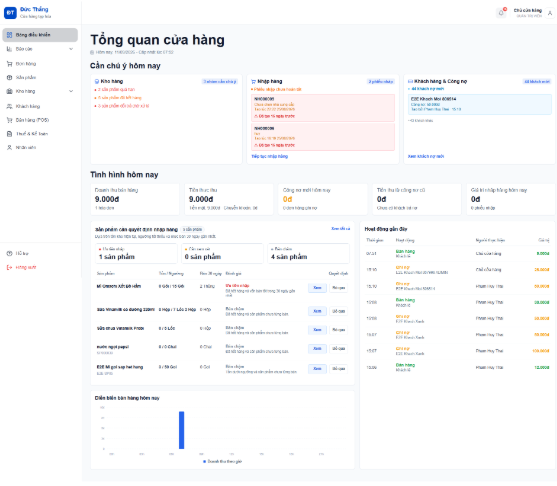
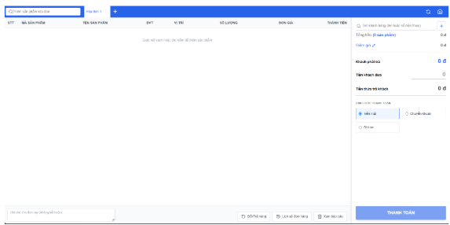
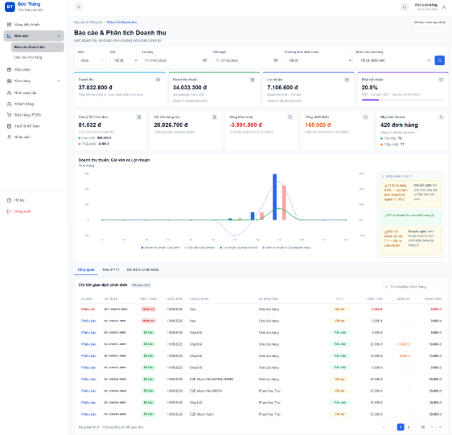
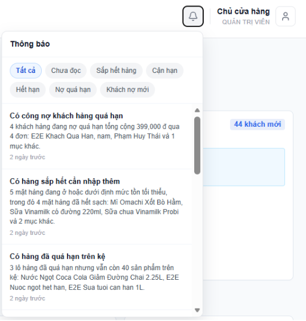
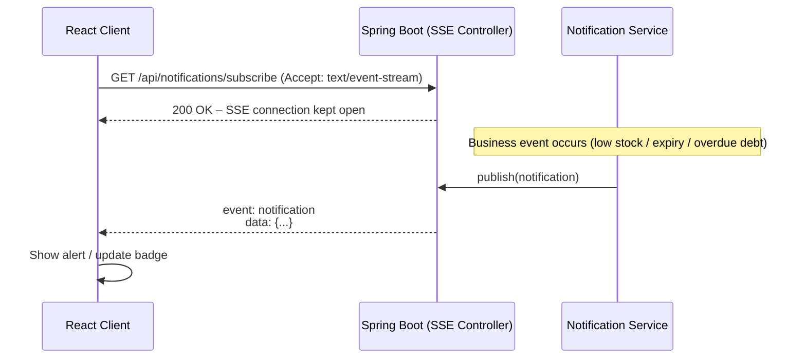

# Grocery Store Management System

A web-based management system for household grocery businesses (hộ kinh doanh), built for a real grocery store to digitize its manual daily operations: sales, inventory, customer debts, revenue reporting and tax declaration.

> Graduation project (SEP490 – FPT University, Summer 2026), team of 5. Successfully defended.
> Original team repository: [lethang1407/SU26_SEP490_G67](https://github.com/lethang1407/SU26_SEP490_G67)

## Tech Stack

| Layer | Technologies |
|---|---|
| Backend | Java 21, Spring Boot 4.0, Spring Data JPA, Spring Security (JWT) |
| Frontend | React 19 |
| Database | MySQL |
| Real-time | Server-Sent Events (SSE) |
| Payment | VietQR |
| DevOps & Tools | Docker, GitHub, Jira, Postman |

## Main Features

- **Point of Sale (POS)** – multi-invoice checkout at the counter, paid by cash, bank transfer or on credit
- **Dashboard** – what needs attention today and today's business at a glance
- **Revenue reports** – revenue, cost and profit analytics with flexible filters
- **Real-time notifications** – stock, expiry and debt alerts pushed from server to client via SSE
- Product & inventory management, stock import
- Customer debt management
- Tax declaration support for household businesses
- Role-based access control with JWT

## My Contributions

I worked as a full-stack developer (backend focus) and was responsible for the following modules.

### 1. Dashboard



- **"Needs attention today"**: products running low, out of stock or near expiry; unpaid stock imports; customers with new or overdue debts.
- **"Today's situation"**: sales revenue, actual cash collected, new debts, old debts collected and import value.
- Suggests which products need restocking, based on sales speed and remaining stock.
- Recent activity feed and an hourly sales chart.

### 2. POS (Point of Sale)



- Several invoices open at once in tabs, so the cashier can serve more than one customer in parallel.
- Product search, customer lookup and automatic total calculation, including change due.
- Payment methods: **cash**, **bank transfer** and **on credit**. Paying on credit records a customer debt.
- Order history and product returns/exchanges.

### 3. Revenue Reports



- Filters by year, quarter, date range, payment method and staff member.
- KPIs: revenue, net revenue, profit, profit margin, average order value, cost of goods, returns, total discount and number of orders.
- Combined chart of net revenue, cost of goods and profit over time.
- Paginated transaction detail table with search.

### 4. Real-time Notifications with SSE



- Server-push notification module built with Spring `SseEmitter`. Clients subscribe once and receive events without polling.
- Notification types: **low stock**, **near expiry**, **expired**, **overdue debt** and **new debtor**.
- Read/unread status and filtering by type.



### Also involved in
- Requirements analysis with the store owner: SRS, use case diagrams and sequence diagrams.
- API testing with Postman, task tracking with Jira.

## Getting Started

### Prerequisites
- Java 21, Maven
- Node.js 18+
- MySQL 8 (or Docker)

### Backend
```bash
cd backend
# configure DB connection in src/main/resources/application.properties
mvn spring-boot:run
```

### Frontend
```bash
cd frontend
npm install
npm run dev
```

## Team

| Member | Role |
|---|---|
| Pham Huy Thai ([@huythai2004](https://github.com/huythai2004)) | Full-stack developer – Dashboard, POS, Revenue Reports, SSE Notifications |
| _Member 2_ | _Role_ |
| _Member 3_ | _Role_ |
| _Member 4_ | _Role_ |
| _Member 5_ | _Role_ |
